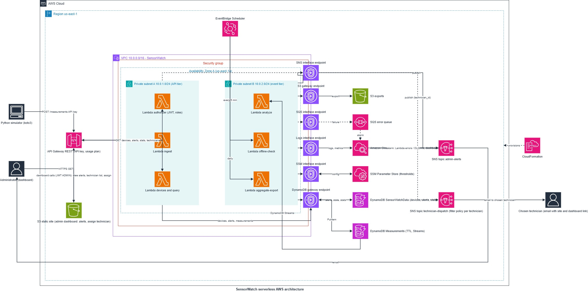

# SensorWatch
## IoT Cloud Monitoring & Anomaly Detection Platform

**Project:** AWS Cloud Architecture  
**Project Name:** SensorWatch  
**AWS Region:** `us-east-1` (N. Virginia)  
**Status:** Under Development

---

# Table of Contents

1. [Context and Problem Definition](#1-context-and-problem-definition)
   - [1.1 Limitations of the Current Situation](#11-limitations-of-the-current-situation)
   - [1.2 Problem to Solve](#12-problem-to-solve)
   - [1.3 Scope](#13-scope)
2. [Project Objectives](#2-project-objectives)
   - [2.1 General Objective](#21-general-objective)
   - [2.2 Specific Objectives](#22-specific-objectives)
   - [2.3 Measuring Success](#23-measuring-success)
3. [System Actors](#3-system-actors)
4. [Actions Associated with Each Actor](#4-actions-associated-with-each-actor)
   - [4.1 IoT Simulator](#41-iot-simulator-simulator-role)
   - [4.2 Administrator](#42-administrator-admin-role)
   - [4.3 Secondary System Actors](#43-secondary-system-actors)
5. [Functional and Non-Functional Requirements](#5-functional-and-non-functional-requirements)
   - [5.1 Functional Requirements](#51-functional-requirements)
   - [5.2 Non-Functional Requirements](#52-non-functional-requirements)
6. [Modules to Develop](#6-modules-to-develop)
   - [6.1 Detection Rules](#61-detection-rules-of-the-anomaly-detection-module)
7. [Design Methodology](#7-design-methodology)
   - [7.1 Planning by Deliverable](#71-planning-by-deliverable)
8. [System Architecture](#8-system-architecture)
   - [8.1 Overview](#81-overview)
   - [8.2 Layered Architecture](#82-layered-architecture)
   - [8.3 Event Flows](#83-event-flows)
   - [8.4 Alert Example](#84-alert-example)
   - [8.5 Learner Lab Constraints](#85-learner-lab-constraints-built-into-the-architecture)
9. [Technology Choices](#9-technology-choices)
   - [9.1 Indicative Cost Estimate](#91-indicative-cost-estimate)
   - [9.2 Main Risks](#92-main-risks)

---

# 1. Context and Problem Definition

A company operates sensors spread across several buildings. Each sensor periodically sends a measurement containing temperature, humidity, battery level and timestamp.

Currently, this data is difficult to exploit in a timely manner, making it challenging to monitor the entire sensor fleet and detect potential problems.

## 1.1 Limitations of the Current Situation

The existing monitoring approach presents several limitations:

- A room may overheat without anyone being notified.
- A sensor may fail or run out of battery without being noticed.
- Measurement history is not centralized, preventing global analysis and statistics.
- A conventional system hosted on a dedicated server requires permanent administration and scales poorly as the number of sensors grows.

## 1.2 Problem to Solve

The objective is to design a cloud platform capable of automatically receiving, storing and analyzing measurements from tens to hundreds of sensors.

The platform must:

- Detect abnormal sensor measurements.
- Identify device failures and offline sensors.
- Present the current state of the sensor fleet to an administrator.
- Provide historical measurements and statistical information.
- Operate without requiring an application server to be managed.

## 1.3 Scope

The project uses a Python simulator to represent physical IoT sensors. No real IoT hardware is required.

No managed IoT service is used. Data ingestion is handled through Amazon API Gateway, respecting the standard capabilities of AWS Academy Learner Lab.

**In Scope:**

- Sensor data ingestion.
- Data validation and storage.
- Anomaly detection.
- Device failure detection.
- Device management.
- Data querying and statistics.
- Report generation and export.
- Monitoring and error handling.
- Web-based administration dashboard.

**Out of Scope:**

- Physical IoT hardware.
- Mobile application.
- Advanced fleet management.

---

# 2. Project Objectives

## 2.1 General Objective

Build an IoT supervision platform entirely based on serverless AWS services.

The system must fundamentally depend on AWS: removing AWS from the architecture should make the system non-functional, rather than simply removing its hosting environment.

## 2.2 Specific Objectives

| Ref. | Objective | Success Criterion |
|---|---|---|
| O1 | Receive and retain measurements | All valid measurements are stored at the 10- and 100-sensor levels. |
| O2 | Automatically detect anomalies | An injected anomaly is detected and an alert is created in under 20 seconds. |
| O3 | Detect offline devices | A device is marked OFFLINE at most 2 minutes after the configured delay. |
| O4 | Supervise the sensor fleet | Each sensor is displayed as ONLINE, OFFLINE or ALERT. |
| O5 | Sustain load growth | Tests with 10, 100 and 500 sensors are documented. |
| O6 | Control costs | Total consumption remains below 20% of the Learner Lab credit. |
| O7 | Provide a reproducible baseline | Deployment can be performed from a blank repository using scripts. |

## 2.3 Measuring Success

Each objective will be verified through demonstrations or automated tests.

Detection times (O2 and O3) will be measured using the timestamp of the injected measurement and the timestamp of the generated alert or state change.

Load testing results (O5) will document:

- Response time.
- Number of requests processed.
- Error rate.

---

# 3. System Actors

The system involves four main actors:

**1. IoT Simulator (System Actor)**

A Python program using Boto3 that generates and sends measurements for 10, 100 or 500 simulated sensors.

**2. Administrator (Human Actor – ADMIN role)**

The person responsible for managing devices, viewing measurements and supervising the entire sensor fleet.

**3. Scheduler (Secondary System Actor – EventBridge)**

Periodically triggers device failure checks and data aggregation tasks.

**4. Analysis Engine (Secondary System Actor – Lambda)**

Analyzes each stored measurement, detects anomalies, generates alerts and updates device states.

---

# 4. Actions Associated with Each Actor

## 4.1 IoT Simulator (SIMULATOR role)

The IoT simulator is responsible for:

- Generating measurements for a configurable number of sensors.
- Sending measurements to the platform through the REST API.
- Deliberately injecting anomalies or failures for testing.
- Running load tests with different numbers of sensors.
- Recording response times and test results.

## 4.2 Administrator (ADMIN role)

The administrator interacts with the monitoring dashboard and can:

- Register a device using its identifier, location, type and status.
- View the list of registered devices and their statuses.
- View individual device details.
- Deactivate or reactivate a device.
- View measurement history over a selected period.
- View and acknowledge generated alerts.
- Consult statistics, including:
  - Average measurements.
  - Minimum values.
  - Maximum values.
  - Number of anomalies.
  - Number of active devices.
- Access the centralized supervision dashboard.

## 4.3 Secondary System Actors

**Analysis Engine**

- Applies detection rules to each new measurement.
- Generates structured alerts.
- Updates the corresponding device state.

**Scheduler**

- Every 5 minutes, checks devices that have stopped sending measurements.
- Marks silent devices as OFFLINE.
- Every day, calculates aggregated statistics.
- Exports daily reports to Amazon S3.

---

# 5. Functional and Non-Functional Requirements

## 5.1 Functional Requirements

The platform must implement the following functional requirements:

| ID | Functional Requirement | Actor |
|---|---|---|
| FR1 | Register, view and deactivate a device. | ADMIN |
| FR2 | Receive JSON measurements and store them. | SIMULATOR |
| FR3 | Validate measurements and reject invalid data with a precise error message. | System |
| FR4 | Ignore duplicate measurements from the same device with the same timestamp. | System |
| FR5 | Automatically detect at least one type of anomaly. | Analysis Engine |
| FR6 | Generate structured alerts containing the sensor identifier, measured value and reason. | Analysis Engine |
| FR7 | Detect offline devices when no measurement is received within a configured duration. | Scheduler |
| FR8 | Aggregate statistics: average, minimum, maximum, number of anomalies and active devices. | Scheduler |
| FR9 | Display measurement history for a selected device and period, such as the last 24 hours. | ADMIN |
| FR10 | Display each sensor's state: ONLINE, OFFLINE or ALERT. | ADMIN |
| FR11 | Export a daily report to Amazon S3. | Scheduler |
| FR12 | Authenticate actors and control access according to their roles. | System |

### Reference Measurement Format

Each measurement follows this JSON structure:

```json
{
  "device_id": "TH-B2-014",
  "temperature": 23.4,
  "humidity": 48.2,
  "battery": 87,
  "timestamp": "2026-10-05T09:15:00Z"
}
```

**Optional Extension:**

A sequence number (`seq`) can be added to detect duplicate or lost measurements.

### Anomaly Example

Consider the following temperature series:

```text
22, 23, 24, 25, 24, 23
```

These measurements represent normal behavior.

However, if a sensor sends a temperature value of `79`, the system must automatically detect the anomaly and generate an alert indicating:

- Sensor identifier.
- Abnormal measured value.
- Reason for triggering the alert.

## 5.2 Non-Functional Requirements

| Category | Requirement |
|---|---|
| Performance and Latency | Measure API response time (mean, 95th percentile and maximum) at 10, 100 and 500 sensors. |
| Scalability | Support increasing measurement volumes using AWS Lambda and on-demand DynamoDB. |
| Availability | Avoid permanent server administration and preserve data across Learner Lab sessions. |
| Reliability | Prevent silent failures, send analysis errors to an error queue and ensure idempotent ingestion. |
| Detection Reliability | Document algorithm limitations, including false positives, cold starts and slow drifts. |
| Security | API key for the simulator, signed administrator token, role-based access and no secrets in the repository. |
| Monitoring | Structured logs, custom metrics, alarms and CloudWatch dashboards. |
| Error Handling | Use consistent HTTP status codes and a unified error response format. |
| Cost | Perform timed 500-sensor tests, use TTL on measurements and reduce log retention. |
| Maintainability | Separate business logic from handlers, document code and provide automated tests. |
| Reproducibility | Provide scripted deployment and complete project documentation. |
| Learner Lab Constraints | Use the `us-east-1` region, LabRole only and verify services before integration. |

### Standard HTTP Status Codes

The API will use the following status codes:

- `200` – Successful request.
- `201` – Resource successfully created.
- `400` – Invalid request.
- `401` – Unauthorized.
- `403` – Forbidden.
- `404` – Resource not found.
- `409` – Conflict.
- `429` – Too many requests.
- `500` – Internal server error.

---

# 6. Modules to Develop

The project is divided into twelve development modules.

| Ref. | Module | Description | Technologies |
|---|---|---|---|
| M1 | IoT Simulator | Generates measurements and injects anomalies and failures. | Python, Boto3, Requests |
| M2 | Ingestion | Receives, validates and stores measurements. | API Gateway, Lambda, DynamoDB |
| M3 | Device Management | Manages the device lifecycle. | Lambda, DynamoDB |
| M4 | Authentication and Authorization | Verifies API keys, tokens and user roles. | Lambda Authorizer, API Gateway Usage Plan |
| M5 | Querying | Provides measurement history, alerts, statistics and dashboard data. | Lambda, DynamoDB |
| M6 | Anomaly Detection | Applies detection rules and generates alerts. | Lambda, DynamoDB Streams |
| M7 | Failure Detection | Detects silent devices and marks them OFFLINE. | EventBridge, Lambda |
| M8 | Aggregation and Export | Calculates statistics and exports reports. | EventBridge, Lambda, S3 |
| M9 | Web Dashboard | Displays sensor statuses, measurements and alerts. | React, JavaScript, CSS, S3 |
| M10 | Monitoring and Errors | Handles logs, metrics, alarms and error queues. | CloudWatch, SQS |
| M11 | Tests | Performs unit, API, failure and load testing. | Pytest, Moto, Postman, Load Test Scripts |
| M12 | Deployment and Tooling | Provides reproducible deployment, initialization and cleanup. | AWS SAM or CloudFormation, Boto3 |

## 6.1 Detection Rules of the Anomaly Detection Module

The anomaly detection module applies the following rules:

| Code | Rule | Principle |
|---|---|---|
| R1 | Threshold | Detects values outside the configured range. |
| R2 | Sudden Variation | Detects an absolute difference between two consecutive measurements greater than a configured delta. |
| R3 | Statistical Deviation | Detects a Z-score greater than 3 over the last 20 measurements, after at least 10 measurements. |
| R4 | Low Battery | Detects battery levels below 15%. |
| R5 | Device Failure | Detects devices that have not sent measurements within the configured delay. |

Detection thresholds will be configurable through AWS Systems Manager Parameter Store.

---

# 7. Design Methodology

The project follows an iterative and incremental development methodology inspired by Scrum.

The planned development cycle consists of 14 weeks, divided into deliverables, with a short demonstration every week.

### Requirements Analysis

- Identify system actors.
- Define UML use cases.
- Identify functional and non-functional requirements.

### Event-Driven Design

Identify the main system events before selecting AWS services:

- Measurement received.
- Alert created.
- Device becomes silent.
- Device status updated.
- Daily report generated.

### Data Design

Design the DynamoDB database according to access patterns, including:

- Partition keys.
- Sort keys.
- Secondary indexes.

### API Design

Follow an API-first approach by preparing the OpenAPI specification before implementation.

### Infrastructure

Use Infrastructure as Code (IaC) through AWS SAM or CloudFormation to ensure reproducible deployment.

### Quality Assurance

- Implement tests from the prototype stage.
- Separate business logic from Lambda handlers.
- Perform code reviews between team members.

### Project Management

- Maintain a shared Git repository.
- Use feature branches.
- Maintain a weekly development backlog.
- Track task distribution and progress.

### Learner Lab Adaptation

Verify the availability of each AWS service before integration and document fallback solutions.

## 7.1 Planning by Deliverable

| Deliverable | Weeks | Content |
|---|---|---|
| Requirements Specification | 1 | Requirements and project documentation. |
| AWS Architecture | 2 | Architecture diagram, service justification and Learner Lab verification. |
| Database and API | 3 | DynamoDB model, REST API, Lambda, CRUD operations, validation and error handling. |
| First Prototype | 4 | Live end-to-end demonstration of a minimal scenario. |
| Full AWS Integration | 5 | S3, Lambda events, CloudWatch and Boto3 scripts. |
| Advanced Feature | 6 | Anomaly detection demonstrated using injected abnormal data. |
| Testing and Optimization | 6 | Automated tests, 10/100/500 sensor load testing, monitoring, error handling and cost analysis. |

---

# 8. System Architecture

## 8.1 Overview

SensorWatch follows a serverless, event-driven architecture hosted on Amazon Web Services.

The architecture connects the IoT simulator, REST API, Lambda functions, DynamoDB databases, event services, monitoring services and administrator dashboard.

### Architecture Diagram



*Figure 1 – SensorWatch Serverless AWS Architecture*

### Main Components

**1. Data Generation**

- Python IoT Simulator.
- Boto3.
- Simulated measurements from multiple sensors.

**2. API Layer**

- Amazon API Gateway REST.
- API Key.
- Usage Plan.
- Lambda Authorizer.

**3. Compute Layer**

- Lambda Authorizer.
- Lambda Ingest.
- Lambda Devices and Query.
- Lambda Analyze.
- Lambda Offline Check.
- Lambda Aggregate Export.

**4. Database Layer**

- DynamoDB Measurements.
- DynamoDB SensorWatchData.
- DynamoDB Devices
- DynamoDB Users
**5. Event and Messaging Layer**

- DynamoDB Streams.
- Amazon EventBridge.
- Amazon SNS.
- Amazon SQS.

**6. Storage and Export**

- Amazon S3 Static Website.
- Amazon S3 Reports and Exports.

**7. Monitoring and Configuration**

- Amazon CloudWatch.
- AWS Systems Manager Parameter Store.

**8. Frontend**

- React-based administrator dashboard.
- Device monitoring.
- Measurement visualization.
- Alert management.
- API integration.

## 8.2 Layered Architecture

The system is organized into five main layers.

### Presentation Layer

React-based web dashboard hosted on Amazon S3.

Responsibilities:

- Display sensor measurements.
- Present device statuses.
- Display alerts and statistics.
- Communicate with backend APIs.
- Provide the administrator interface.

### API Layer

Amazon API Gateway and Lambda Authorizer.

Responsibilities:

- API routing.
- Authentication.
- Authorization.
- API key management.
- Usage plans.
- Request validation and rate limiting.

### Business Logic Layer

AWS Lambda functions.

Responsibilities:

- Measurement ingestion.
- Device management.
- Data querying.
- Anomaly detection.
- Offline device detection.
- Statistical aggregation.
- Report export.

### Data Layer

Amazon DynamoDB and Amazon S3.

Responsibilities:

- Measurement persistence.
- Device information storage.
- Alert and statistics storage.
- Historical data management.
- Report archiving.

### Cross-Cutting Services

Amazon CloudWatch, EventBridge, SQS and SSM Parameter Store.

Responsibilities:

- Monitoring and logging.
- Scheduled events.
- Error management.
- Configuration management.

## 8.3 Event Flows

### Flow 1 – Measurement Insertion

1. The Python simulator generates a sensor measurement.
2. The simulator sends the measurement through API Gateway.
3. Lambda Ingest validates the request.
4. The measurement is stored in DynamoDB Measurements.
5. DynamoDB Streams triggers Lambda Analyze.
6. The detection rules are applied.
7. An alert is created if an anomaly is detected.
8. The device state is updated in DynamoDB SensorWatchData.

### Flow 2 – Analysis Failure

1. Lambda Analyze processes a measurement.
2. If analysis fails, the error is sent to Amazon SQS.
3. CloudWatch receives the corresponding logs and metrics.
4. A CloudWatch alarm can notify administrators through Amazon SNS.

This mechanism prevents silent loss of processing errors.

### Flow 3 – Offline Device Detection

1. EventBridge triggers Lambda Offline Check every 2 minutes.
2. The function identifies devices that have stopped sending measurements.
3. The corresponding devices are marked as OFFLINE.
4. The updated status becomes available to the administrator dashboard.

### Flow 4 – Daily Aggregation and Export

1. EventBridge triggers Lambda Aggregate Export daily.
2. The function calculates aggregated statistics.
3. The report is generated.
4. The report is exported to Amazon S3.

## 8.4 Alert Example

The platform generates structured alerts containing the device identifier, anomaly type, measured value, reason, severity, creation timestamp and status.

Example:

```json
{
  "alert_id": "01J9XK",
  "device_id": "TH-B2-014",
  "type": "THRESHOLD",
  "metric": "temperature",
  "value": 79.0,
  "reason": "Temperature 79.0 above maximum threshold 45.0",
  "severity": "HIGH",
  "created_at": "2026-10-05T09:15:02Z",
  "status": "OPEN"
}
```

## 8.5 Learner Lab Constraints Built into the Architecture

The architecture takes into account AWS Academy Learner Lab restrictions.

- All Lambda functions and AWS resources use the provided `LabRole`.
- No IAM role is created.
- The project uses a single AWS region: `us-east-1`.
- The architecture is fully serverless.
- Data must persist across Learner Lab sessions.

### Fallback Solutions

| Service | Fallback Solution |
|---|---|
| EventBridge | Scheduled tasks triggered by a Boto3 script. |
| SSM Parameter Store | Lambda environment variables. |
| DynamoDB Streams | Asynchronous invocation of Lambda Analyze by Lambda Ingest. |

No managed IoT service is used. All measurement ingestion goes through Amazon API Gateway.

---

# 9. Technology Choices

The following AWS services and technologies have been selected according to project requirements and Learner Lab constraints.

| Need | Technology | Justification |
|---|---|---|
| API Entry Point | API Gateway REST | Supports API keys, usage plans, authorizers and request validation. |
| Business Logic | AWS Lambda – Python 3.12 | Serverless execution, pay-per-execution billing and automatic scaling. |
| Database | Amazon DynamoDB | On-demand capacity, low latency, Streams and TTL support. |
| Archives and Static Website | Amazon S3 | Durable and low-cost storage, static website hosting and report archiving. |
| Events | DynamoDB Streams and EventBridge | Event-driven processing and native scheduling. |
| Failure Handling | Amazon SQS | Decouples processing and prevents silent event loss. |
| Monitoring | Amazon CloudWatch | Integrated logs, metrics, alarms and monitoring. |
| Authentication | API Key and Lambda Authorizer (JWT) | Supports SIMULATOR and ADMIN roles within the project constraints. |
| Configuration | AWS Systems Manager Parameter Store | Allows thresholds to be modified without redeployment. |
| Scripts and Tests | Python, Boto3, Requests, Pytest, Moto, Postman | Supports automation, unit testing and API validation. |
| Infrastructure Deployment | AWS SAM or CloudFormation | Enables reproducible infrastructure deployment. |
| Frontend | React, JavaScript and CSS | Provides a component-based administrator dashboard. |

### Technology Alternatives

The following alternatives were considered but rejected according to the project constraints:

- EC2 web server: requires permanent server administration.
- ECS containers: unnecessary for the serverless architecture.
- RDS: requires database server management and is less suited to the proposed time-series access patterns.
- EFS: unnecessary for the selected storage requirements.
- Polling loops: replaced by EventBridge and event-driven processing.
- Amazon Cognito: considered only if available within the Learner Lab environment.

## 9.1 Indicative Cost Estimate

The AWS Academy Learner Lab credit is limited and is often around 50 USD per student.

The three planned test levels represent approximately:

| Simulated Sensors | Approximate Requests |
|---|---:|
| 10 sensors | 600 |
| 100 sensors | 6,000 |
| 500 sensors | 15,000 |

The expected consumption for Lambda, API Gateway and on-demand DynamoDB is well below 1 USD for these test workloads, subject to actual usage and service configuration.

### Cost Optimization Practices

- Perform short, timed tests.
- Use Lambda memory between 128 and 256 MB where appropriate.
- Configure TTL on the Measurements table.
- Limit CloudWatch log retention to 7 days.
- Monitor consumption during testing.
- Clean up unnecessary AWS resources after sessions.

## 9.2 Main Risks

| Risk | Impact | Mitigation |
|---|---|---|
| AWS service unavailable in Learner Lab | Integration delays. | Verify service availability and prepare fallback solutions. |
| Credit exhausted during 500-sensor tests | Testing interruption. | Perform a single short test and monitor consumption. |
| AWS quotas reached at 500 sensors | Limited scalability validation. | Document the actual test results and limitations. |
| Work concentrated at the end of the semester | Delayed delivery. | Use milestones and weekly demonstrations. |
| False positives in anomaly detection | Incorrect alerts. | Use configurable thresholds, duplicate prevention and documented detection limitations. |

---

# Project Status

**Current Status:** Under Development

The project is being developed incrementally according to the defined architecture and functional requirements.

The main development priorities are:

- AWS backend implementation.
- React administrator dashboard development.
- Integration between frontend and backend APIs.
- Anomaly detection and device failure monitoring.
- Automated testing and performance validation.
- Infrastructure deployment and final integration.

---

# License

Academic project. License to be determined.

---

**SensorWatch – IoT Cloud Monitoring & Anomaly Detection Platform**  
*Serverless AWS Architecture | Academic Project | 2026–2027*